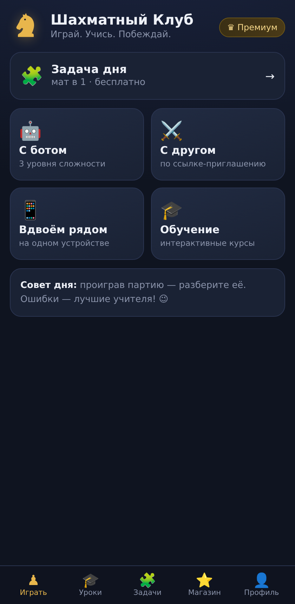
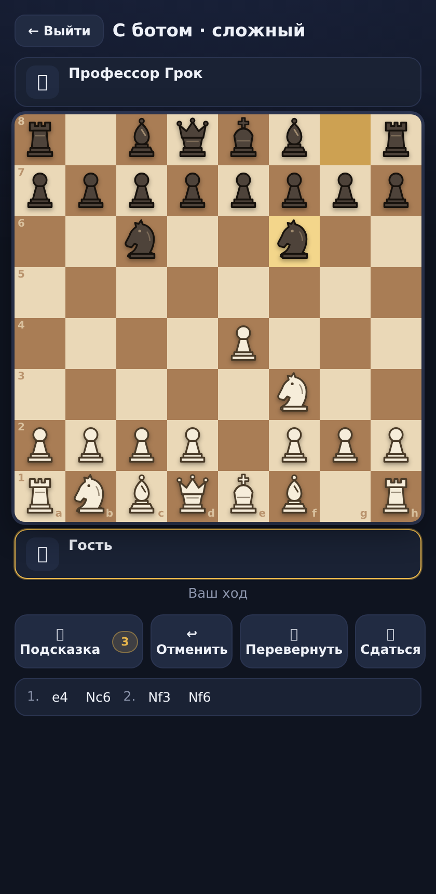
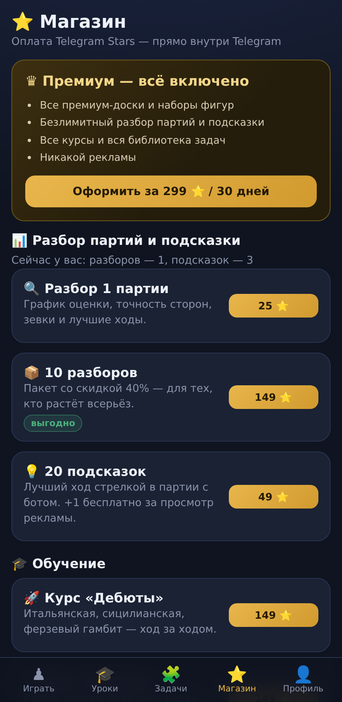

# ♟ Шахматный Клуб — Telegram Mini App

**🌐 Live-демо: https://chess-club-1sph.onrender.com** (деплой на Render Free + Neon Postgres)

Полноценная шахматная игра для Telegram: бот с тремя уровнями сложности, игра с друзьями
по ссылке-приглашению, интерактивное обучение, задача дня, разбор партий и монетизация
через **Telegram Stars** + рекламу **Adsgram**.

  

## Что внутри

| Режим | Описание |
|---|---|
| 🤖 **С ботом** | 3 уровня: лёгкий (зевает фигуры), средний (клубный), сложный (альфа-бета + quiescence, итеративное углубление). Подсказки, отмена хода, сохранение и возобновление партии, опциональные часы и рейтинговый режим |
| ⚔️ **С другом** | Комнаты с кодом и deep-link приглашением `t.me/bot/app?startapp=join_CODE`. Серверная валидация ходов (chess.js), часы (3+2 / 5+0 / 10+0), ничья по соглашению, сдача, реванш со сменой цвета, реконнект 3 мин, быстрые фразы |
| 📱 **Вдвоём рядом** | Один девайс на двоих, автоповорот доски |
| 🎓 **Обучение** | 13 интерактивных уроков в 4 курсах: основы (бесплатно), дебюты, тактика, эндшпиль. Ученик делает ходы прямо на доске |
| 🧩 **Задачи** | 12 задач (мат в 1–2, вилки, связки, сквозные удары, мат Филидора). Задача дня бесплатно + стрик 🔥 |
| 🏆 **Рейтинг** | Elo-рейтинг (старт 1200): очки за победу, минус за поражение. Рейтинговые партии с другом (K=32) и ботом (K=20, рейтинг бота зависит от сложности). Таблица лидеров: все игроки + вкладка «Друзья» (соперники, с кем играл), никнеймы из Telegram |
| ⏱ **Шахматные часы** | Отдельная настройка в партии с ботом и с другом: без часов / 3+2 / 5+0 / 10+0. Серверные часы для друга, клиентские для бота; флаг = поражение |
| 🎖 **Достижения** | 16 ачивок с векторными бейджами (бронза/серебро/золото): первая победа, серии, 10/50 побед, победа над сложным ботом, без подсказок, задачи, уроки, рейтинговые рубежи, премиум. Сетка в профиле + модалка/тост при разблокировке |
| 📊 **Разбор партии** | График оценки, точность сторон (формула win% как у Lichess), классификация каждого хода (лучший/хороший/неточность/ошибка/зевок), лучшие ходы стрелками, навигация по партии |

**Монетизация** (подробно — в [MONETIZATION.md](MONETIZATION.md)):
премиум-подписка, разборы партий, подсказки (+ rewarded-реклама), курсы, задачи,
4 премиум-доски, 3 набора фигур, отключение рекламы. Оплата — Telegram Stars (XTR).

## Быстрый старт (демо-режим, без Telegram)

```bash
npm install
npm start          # http://localhost:3000
```

Без `BOT_TOKEN` сервер работает в демо-режиме: все покупки симулируются (кнопка
«Купить (демо)»), реклама показывается заглушкой, профиль — гостевой. Удобно
тестировать весь функционал в обычном браузере.

## Запуск в Telegram (продакшен)

**Пошаговая инструкция для новичка (бесплатные сервисы + что прислать ассистенту для автодеплоя) — в [DEPLOY.md](DEPLOY.md).**

1. **Бот**: у [@BotFather](https://t.me/BotFather) → `/newbot` → получите `BOT_TOKEN`.
2. **Мини-апп**: `/newapp` → выберите бота → укажите HTTPS-URL задеплоенного приложения
   (например `https://chess.example.com`) → получите short name (`APP_SHORT_NAME`).
3. **Деплой** (любой хостинг с HTTPS):
   ```bash
   docker build -t chess-club .
   docker run -d -p 3000:3000 --env-file .env chess-club
   ```
   или `node server/index.js` за reverse-proxy (nginx/Caddy) с TLS.
   Подойдут Railway / Fly.io / Render / VPS. WebSocket работает на том же порту (`/ws`).
4. **`.env`** (см. `.env.example`): `BOT_TOKEN`, `WEBAPP_URL`, `APP_SHORT_NAME`,
   `SUPPORT_USERNAME`, `TERMS_URL`.
5. **Реклама**: зарегистрируйтесь в [Adsgram](https://adsgram.ai) (официальный партнёр
   Telegram Mini Apps), создайте Interstitial и Rewarded блоки →
   `ADSGRAM_INTERSTITIAL_ID`, `ADSGRAM_REWARDED_ID`.
6. **Платежи**: ничего подключать не нужно — Stars работают из коробки через
   `createInvoiceLink` (currency `XTR`). Бот сам обрабатывает `pre_checkout_query`
   и `successful_payment` и выдаёт покупки. Команды `/paysupport` и `/terms`
   уже реализованы (требование Telegram для цифровых товаров).

Бот автоматически ставит кнопку меню «♟ Играть» (`setChatMenuButton`).

## Архитектура

```
public/            фронтенд мини-аппа (ванильный JS, ES-модули, без сборки)
  js/board.js      компонент доски: drag&drop + tap-tap, анимации, промо, стрелки
  js/engine.js     движок: оценка + negamax/alpha-beta + quiescence
  js/ai-worker.js  Web Worker (бот и анализ не блокируют UI) + фолбэк на main thread
  js/game-bot.js   партия с ботом        js/game-friend.js  WS-партии + лобби
  js/lessons.js    курсы                 js/puzzles.js      задачи
  js/analysis.js   разбор партий         js/store.js        магазин
  js/tg.js         мост Telegram: initData, Stars, Adsgram, haptics, share
  vendor/chess.js  chess.js (BSD) — единый модуль правил для браузера и сервера
server/
  index.js         Express + REST API + WebSocket + запуск бота
  rooms.js         комнаты: сервер-authoritative ходы, часы, реконнект
  bot.js           long-polling бот: /start, приглашения, платежи Stars
  db.js            JSON-хранилище (для продакшена → Postgres, см. ниже)
  catalog.js       каталог товаров и цен (единый источник правды)
  telegram.js      валидация initData (HMAC), createInvoiceLink
tests/
  run.js           89 тестов: легальность всех уроков/задач, движок, API, WS-комнаты
  e2e.js           30 E2E-тестов в headless Chrome (puppeteer): клики по доске,
                   покупки, уроки, задачи, две вкладки друзей, разбор
```

### Безопасность
- Каждый API-запрос проверяется по `initData` (HMAC-SHA256, срок 24 ч).
- Ходы в партии с другом проверяет **сервер** — клиент не может сжульничать.
- Демо-покупки доступны только при `DEMO_MODE` (выключены с `BOT_TOKEN`).
- Выдача покупок — только по `successful_payment` от Telegram, не по клиенту.
- Реконнект не может «угнать» активную сессию с другого устройства.

### Что улучшить для большого продакшена
- **БД**: локально `db.js` хранит данные в JSON-файле; в продакшене задайте
  `DATABASE_URL` (бесплатный Neon Postgres) — данные переживут рестарты.
  Graceful-shutdown (SIGTERM) сбрасывает данные перед остановкой.
- **Разбор**: сейчас считается на клиенте (быстро и бесплатно для сервера). Чтобы
  нельзя было обойти оплату через devtools — перенесите `analyzeFen` на сервер
  (тот же chess.js уже там) и отдавайте готовый результат после проверки оплаты.
- **Подписка**: премиум реализован как разовая покупка на 30 дней. Для автосписания
  добавьте `subscription_period: 2592000` в `createInvoiceLink` (Stars-подписки,
  Bot API 9.1+) и обработку `subscription_updated`.
- **Масштабирование комнат**: комнаты в памяти одного процесса; для нескольких
  инстансов — sticky sessions или Redis pub/sub.

## Тесты

```bash
npm test                 # 89 unit/API/WS тестов
node tests/e2e.js        # 30 E2E (нужен запущенный сервер и puppeteer)
```

## Лицензии
- chess.js — BSD-2 (файл `public/vendor/chess.js.LICENSE`).
- Фигуры и доски — собственная SVG-отрисовка проекта.
